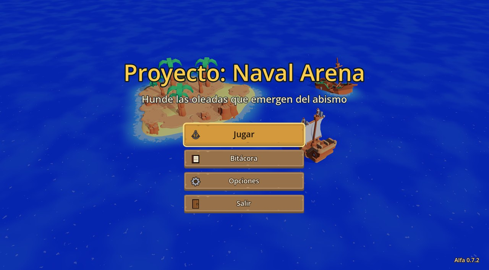
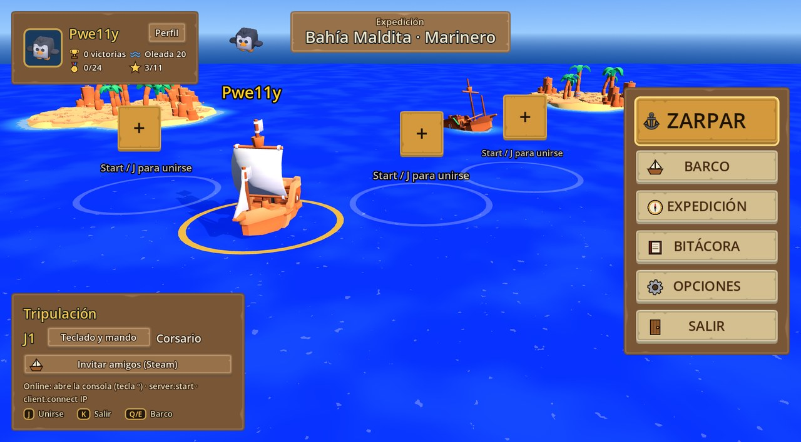
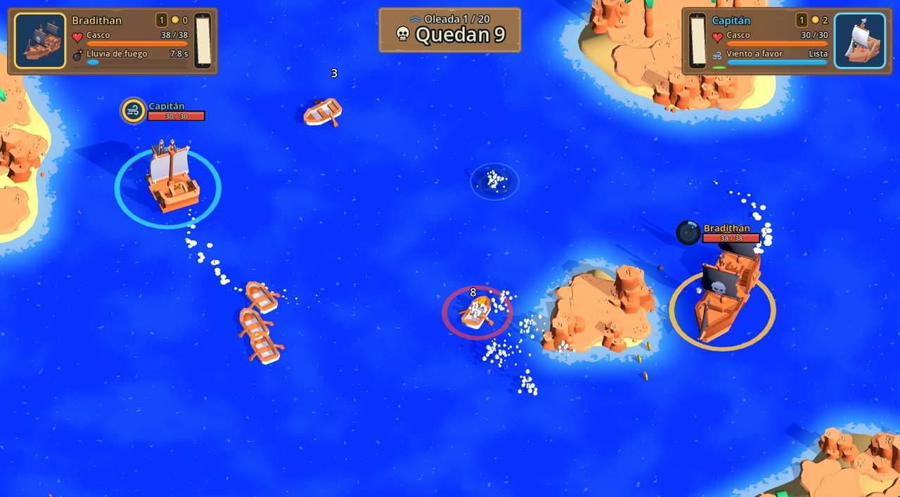
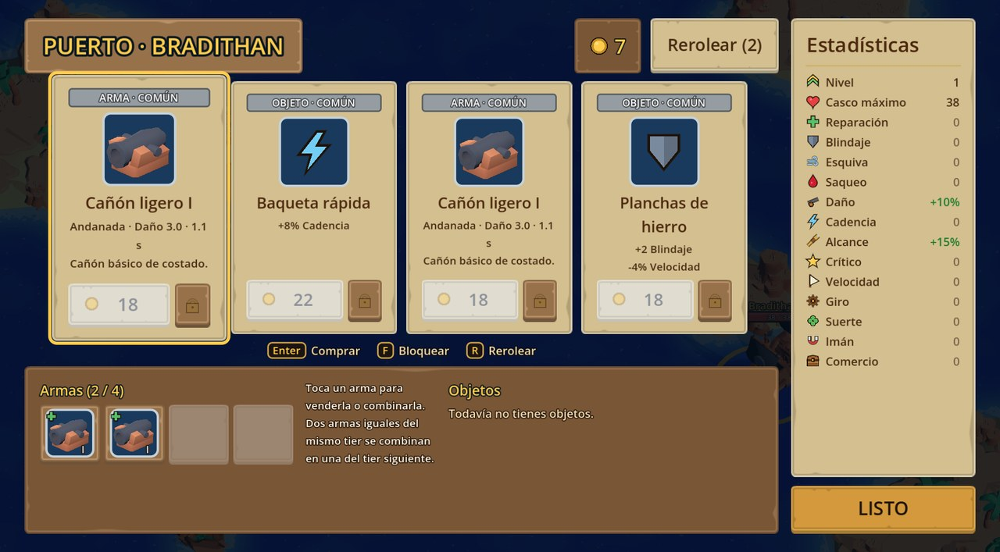

# Naval Arena — versiones para jugar

Roguelite de arena por oleadas con barcos en 3D (estilo **Brotato**): capitaneas un barco mientras los enemigos **emergen desde el fondo del mar**. Entre oleadas mejoras tu barco en el puerto con cañones, velas, blindaje y objetos. Solo o en cooperativo de hasta 4 jugadores (en la misma pantalla u online).

> **Alfa:** el juego está en desarrollo. Aquí solo se publican las versiones compiladas; el código está en otro repositorio.

## Descargar e instalar (Windows)

1. Descarga el zip de la última versión desde [**Releases**](https://github.com/BradithanApps/naval-arena-releases/releases/latest) (`NavalArena-<versión>-windows.zip`). Las versiones anteriores siguen disponibles en la [lista de Releases](https://github.com/BradithanApps/naval-arena-releases/releases).
2. Descomprímelo en una carpeta tuya (Escritorio, Documentos…). **No** en *Archivos de programa*: el juego necesita poder escribir ahí para actualizarse.
3. Abre **`Naval Arena.exe`**. Deja todos los archivos juntos: las dos DLL que van a su lado son las de Steam.

Con **Steam** abierto, el juego usa tu nombre y foto de Steam y puedes invitar a tus amigos desde el Puerto.

## Actualizaciones automáticas

Al abrir el juego, la pantalla de título comprueba si hay una versión nueva. Si la hay, aparece un aviso abajo a la derecha con las novedades y el botón **Actualizar**: el juego la descarga, se cierra, la instala y se vuelve a abrir solo. Tus partidas guardadas no se tocan.

Para jugar online, todos deben tener **la misma versión**.

## Capturas

**El Puerto:** tu barco y los de tu tripulación. Desde aquí eliges barco, mapa y dificultad, e invitas a tus amigos.

**En combate:** cada barco lleva encima su nombre, su casco y el círculo de la habilidad, que se llena mientras recarga.

**Entre oleadas:** compra armas y objetos con los doblones que sueltan los enemigos.

## Controles

| Acción | Teclado | Mando |
|---|---|---|
| Navegar | WASD / flechas | Stick izquierdo |
| Bajar / subir la vela | W / S | R2 / L2 |
| Habilidad del barco | Espacio | A |
| Pausa | Esc | Start |
| Unirse al cooperativo (en el Puerto) | J | Start |

Al zarpar se muestra una guía con los controles de cada jugador.

## Jugar online

- **Con Steam:** en el Puerto, el **+** de un puesto libre o *Invitar amigos (Steam)*. El amigo acepta la invitación desde Steam.
- **Por IP:** abre la consola con la tecla **º** (a la izquierda del 1). El anfitrión escribe `server.start` y los demás `client.connect IP`. Por internet, el anfitrión debe abrir el puerto 7777 (UDP) o usar una VPN como Tailscale o ZeroTier.

## Partidas guardadas

`%APPDATA%\Godot\app_userdata\Proyecto- Naval Arena`

## Créditos

Modelos y UI: [Kenney](https://kenney.nl) (CC0). Hecho con [Godot](https://godotengine.org) y [GodotSteam](https://godotsteam.com).
